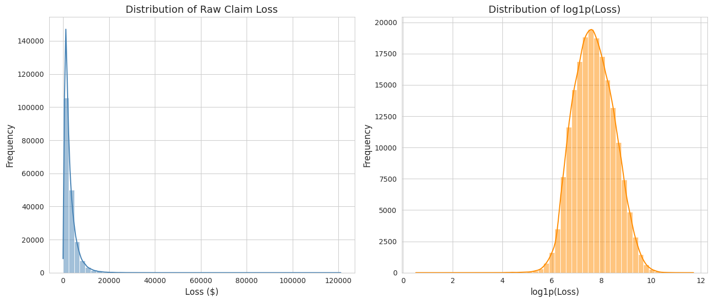
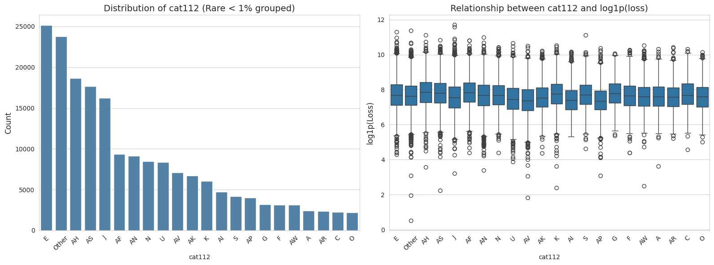
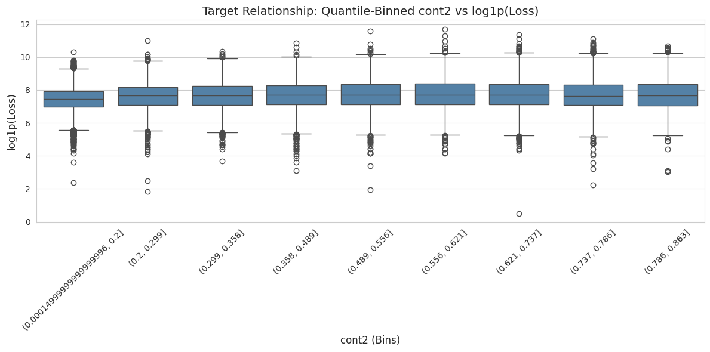

# AI Studio Challenge Project Title

---

### **Team Members**


| Name             | GitHub Handle                         | Contribution                                                                                                              |
| ---------------- | ------------------------------------- | ------------------------------------------------------------------------------------------------------------------------- |
| Nevaeh Dickerson | [@vaeh4codes](https://github.com/vaeh4codes) | [September EDA](artifacts/september/gate4-september-milestone-reproducible-project/), the [October modeling plan and split](artifacts/october/gate1-issue-reproducible-project/), and the [Gate 4 comparison](artifacts/october/gate4-october-milestone-reproducible-project/) |
| Matthew Tan      | [@mtan121](https://github.com/mtan121) | [Gate 2](notebooks/OctoberMilestones/October_Gate_2.ipynb)                                                                |
| Andre Miller     | [@andredmiller12](https://github.com/andredmiller12) | [Gate 3](notebooks/OctoberMilestones/October_Gate_3.ipynb)                                                     |


---

## **- Project Highlights -**

September checked the [source file](data/allstate_claims_data.csv) and explored `loss` on all 188,318 claims. The evidence is in the [September bundle](artifacts/september/gate4-september-milestone-reproducible-project/). October froze a 70/15/15 split, scored a training-mean and a training-median baseline, and compared a random forest with XGBoost on the 28,248 validation claims. That package is in the [October Gate 4 bundle](artifacts/october/gate4-october-milestone-reproducible-project/). Both models beat both baselines. The team did not name a winner: XGBoost is closer overall, and the forest is closer on the 285 largest validation claims. The 28,248 test claims stay unused until November.

---

## **- Setup and Installation -**

Clone the repository and open a notebook from inside that folder. The claims file is already in the clone at [`data/allstate_claims_data.csv`](data/allstate_claims_data.csv) (188,318 rows, 132 columns).

```bash
git clone https://github.com/Break-Through-Tech/Allstate-1D-predicting-auto-claims-severity.git
cd Allstate-1D-predicting-auto-claims-severity
python3 -m venv .venv
source .venv/bin/activate
python -m pip install pandas==3.0.6 numpy==2.5.3 scikit-learn==1.9.1 xgboost==3.4.1 matplotlib seaborn
```

Those package versions are the ones recorded with the October comparison. The September notebooks also import Matplotlib and Seaborn for the figures. Python 3.12 was used for that comparison.

Notebooks are in [`notebooks/SeptemberMilestone/`](notebooks/SeptemberMilestone/) and [`notebooks/OctoberMilestones/`](notebooks/OctoberMilestones/). Each repo notebook looks upward from its folder until it finds [`data/allstate_claims_data.csv`](data/allstate_claims_data.csv), so the same file works on any computer. If a notebook says it could not find that file, start it from a folder inside the clone and run the load cell again. The load pattern is written out in [`docs/notebook-structure.md`](docs/notebook-structure.md).

Google Colab does not have this clone's `data/` folder. For a Colab copy, mount Drive and read the CSV from the path where that person saved it. Comment those Drive lines back out before the notebook is committed.

---

## **- Project Overview -**

This project is part of the **Break Through Tech AI/ML Fellowship with Cornell Tech** for the 2026–2027 cohort. The year-long fellowship consists of four main sections:

- **Spring:** Python Bootcamp
- **Summer:** Machine Learning Certificate Bootcamp
- **Fall:** AI Studio
- **Spring:** AI Specializations

This project takes place during the **Fall AI Studio**, where fellows are placed into teams and partnered with industry host companies to apply their machine learning skills to real-world business problems.

Our team is partnered with **Allstate** to explore how machine learning can improve the estimation of final auto insurance claim costs. Because the final cost of a claim may not be known for months due to factors such as repair timelines and legal determinations, our objective is to develop a machine learning model that can predict the final claim cost using information available when the claim is initially filed.

From a real-world perspective, more accurate early claim estimates could help insurance professionals make better-informed decisions when setting reserves and better understand the factors that contribute to higher claim costs. Ultimately, this work explores how machine learning can support a more efficient and data-driven claims estimation process.

---


## - **Data Exploration -**

### Dataset Overview

Our project uses a historical **Allstate auto insurance claims dataset** provided for the Break Through Tech AI Studio project. The dataset is [`data/allstate_claims_data.csv`](data/allstate_claims_data.csv) and contains **188,318 claim records and 132 columns**. The source check is in [`artifacts/september/gate1-issue-reproducible-project/`](artifacts/september/gate1-issue-reproducible-project/).

Each row represents an individual insurance claim. The dataset contains:

- **1 identifier:** `id`
- **116 categorical features:** `cat1` through `cat116`
- **14 continuous features:** `cont1` through `cont14`
- **1 target variable:** `loss`, representing claim severity/cost

All predictor variables are anonymized, meaning their real-world business meanings are not provided.

### Data Readiness and Validation

Before beginning exploratory analysis, we verified the dataset's structure and integrity. Our checks confirmed that:

- The dataset contains the expected **188,318 rows and 132 columns**
- `id` contains no missing values
- No duplicate rows were identified
- All 14 continuous features are numeric and fall within the expected **0 to 1 range**
- All 116 categorical features are stored as categorical/object data
- The `loss` target is numeric, finite, and positive
- No missing values were identified in the dataset

Based on these checks, the dataset was considered structurally ready for exploratory data analysis.

### Exploratory Data Analysis

September's EDA examined the target distribution and the relationships between the anonymized predictors and claim loss on the full file of 188,318 claims. The tables and figures are in the [September Gate 4 bundle](artifacts/september/gate4-september-milestone-reproducible-project/). That work was finished before October drew the train, validation, and test split, so the later internal scores are a check on a file the team had already explored.

**Target Analysis**

We examined descriptive statistics and the distribution of `loss`. Claim losses range from **$0.67 to $121,012.25**, with a median of **$2,115.57** and mean of approximately **$3,037.34**.

The target distribution is strongly **right-skewed**, with a smaller number of claims having substantially larger losses. Because of this skew, we use `log1p(loss)` for selected visualizations to make patterns across the majority of claims easier to observe.

A median prediction for every row in the full file has a **Mean Absolute Error (MAE) of about $1,809.05**. That figure describes the whole file. October's held-out scores use the training median on the validation claims only, and those scores are in the Model Development section.




**Categorical Features**

Categorical variables were analyzed with frequency counts, rare-level checks, and box plots of `log1p(loss)` across levels. The 116 fields have 1,139 levels in total. Most are small: 72 fields have 2 levels, and 88 have at most 4. A few are wide: `cat116` has 326 levels, `cat110` has 131, and `cat109` has 84. Support is uneven. 227 levels appear on fewer than 10 claims, and 64 levels each cover at least 90% of claims.

For the displays, levels under **1% of claims** were grouped so the smallest groups would not crowd the plots. Those rows stayed in the data. October did not drop a field because a September chart looked sparse.




**Continuous Features**

Continuous variables were explored with summaries, correlations, histograms, box plots, and 10-bin quantile cuts. Every observed `cont*` value sits on a 0-to-1 scale. Some fields move together: `cont11` and `cont12` correlate at about 0.994, `cont1` and `cont9` at about 0.930, and `cont6` and `cont10` at about 0.883. `cont1` lines up with `loss` at about -0.01. October kept all 14 continuous fields. A weak or shared correlation was not treated as a reason to remove one.



### Key Findings

- The file passed the source checks: 188,318 unique ids, 0 duplicate rows, 0 missing cells, and a strictly positive `loss`.
- `loss` is right-skewed (skewness 3.795). The log view is for plots. Scores stay in the original dollar units.
- No rows were removed, including the claim at $121,012.25 and the points outside the continuous-feature whiskers.
- Category levels and continuous bins show statistical associations with `loss`. The labels are anonymous, so those associations are not named business causes.
- The 1% display rule and the 10-bin cuts were for exploration. They were not reused as a fitted feature rule in October.

### Challenges and Limitations

The primary limitation of the dataset is **feature anonymization**. Variables such as `cat1` and `cont1` do not have documented real-world meanings, limiting our ability to explain *why* a particular feature may be associated with claim severity.

For this reason, the EDA records reproducible statistical patterns and does not assign business meanings to the anonymized variables.

### EDA Visualizations

Our analysis includes visualizations such as:

- Raw `loss` distribution vs. `log1p(loss)` distribution
- Categorical feature frequency plots
- Categorical feature vs. `log1p(loss)` box plots
- Continuous-feature correlation analysis
- Quantile-binned continuous feature vs. `log1p(loss)` box plots

These figures are saved with the [September evidence](artifacts/september/gate4-september-milestone-reproducible-project/). They guided the [October modeling plan](artifacts/october/gate1-issue-reproducible-project/modeling-contract.md): keep every anonymous field, keep the high-loss claims, and treat the full-file charts as prior exposure rather than as a training rule.

## **- Model Development -**

---
**Modeling Objective & Evaluation**

The primary objective of this phase is to estimate one claim's final paid amount, `loss`, from the 130 anonymized fields. Those field names do not say which inputs exist when a claim is first filed, so the scores below are a retrospective check on this file.
Because the business goal is to minimize the average dollar amount by which our predictions miss the actual claim costs, we evaluate all models using Mean Absolute Error (MAE) in the original dollar units.

**Data Partitioning & Leakage Prevention**

To test our models and prevent data leakage, we implemented a strict data splitting strategy using a reproducible seed (random_state=1). The dataset of 188,318 claims was divided into three partitions:

Training Set (70%): 131,822 claims used strictly for training the models and fitting preprocessing rules.

Validation Set (15%): 28,248 claims used to compare models, tune hyperparameters, and measure generalization.

Test Set (15%): 28,248 claims strictly held out for the final project evaluation in November.

To ensure consistency across all future experiments, we also generated a machine-readable partition manifest, [`gate1_partition_manifest.csv`](artifacts/october/gate1-issue-reproducible-project/splits/gate1_partition_manifest.csv), that locks every claim ID to its respective partition. The split design is in [`train-validation-design.md`](artifacts/october/gate1-issue-reproducible-project/train-validation-design.md). The Gate 1 notebook is [`OctoberGate1.ipynb`](notebooks/OctoberMilestones/OctoberGate1.ipynb).

**Data Preprocessing Pipeline**

We built an automated preprocessing pipeline using Scikit-Learn to prepare the 130 anonymized features for machine learning algorithms. The training-only code is [`training_preprocessor.py`](artifacts/october/gate4-october-milestone-reproducible-project/preprocessing/training_preprocessor.py), and the field list is [`field_roles.csv`](artifacts/october/gate1-issue-reproducible-project/field_roles.csv). All preprocessing rules were calculated only on the training data before being applied to the validation data to prevent information leakage. The Gate 2 notebook is [`October_Gate_2.ipynb`](notebooks/OctoberMilestones/October_Gate_2.ipynb).

Continuous Features (14): Missing values were imputed using the training median. Features were intentionally left unscaled because tree-based models do not require feature scaling.

Categorical Features (116): Missing values were imputed using the training mode (most frequent level). The categories were then transformed into numeric inputs using One-Hot Encoding. The encoder was configured to safely ignore any previously unseen or rare categories that might appear in the validation or test sets.

**Baselines & Model Selection**

Before training complex models, we established two constant baseline strategies to prove the mathematical value of the machine learning approach:

Mean Baseline: Predicting the average training claim cost for every validation claim yields an MAE of $1,978.40.

Median Baseline: Predicting the median training claim cost yields a stronger baseline MAE of $1,827.31. All models must beat this score.

We selected two distinct tree-based architectures for our initial modeling phase:

Random Forest Regressor: Selected for its ability to naturally capture non-linear relationships among the anonymized fields while resisting overfitting.

XGBoost Regressor: Selected for its powerful gradient boosting architecture, specifically configured to optimize directly for absolute error (reg:absoluteerror).

**Training & Complexity Checks**

Rather than relying on a single training run, we evaluated our model settings using 5-Fold Cross-Validation inside the training set. That comparison is in [`October_Gate_3.ipynb`](notebooks/OctoberMilestones/October_Gate_3.ipynb) and [`validation_mae.csv`](artifacts/october/gate4-october-milestone-reproducible-project/experiments/validation_mae.csv).
To ensure our models were learning real patterns rather than simply memorizing the training data (overfitting), we implemented an automated complexity check. By comparing the models' in-sample training MAE to their 5-fold cross-validation MAE, we verified that both models generalized well. Neither model showed a gap larger than 10%, meaning their depth and complexity settings were fundamentally healthy and did not require artificial restriction.

## - **Results & Key Findings -**

---
Both models have a lower average miss than both baselines on the same 28,248 validation claims. October does not name a model. The two scores are close, and the large-claim check below points the other way. The plain-language account is the [October report](artifacts/october/gate4-october-milestone-reproducible-project/handoff/october_report.md).

Random forest: validation MAE of $1,291.59, about $536 lower than the median baseline.

XGBoost: validation MAE of $1,171.72, about $656 lower than the median baseline. The gap between the two models is about $120, under 10% of the forest score.

**High-Loss Tail Analysis (Extreme Outliers)**

A small percentage of the claims are high-cost outliers. To understand how our models handle these extremes, we split the validation data using the 99th percentile of training loss ($14,017.41).
This revealed a critical trade-off:

On the other 27,963 validation claims, XGBoost's average miss is $1,089 and the forest's is $1,214.

On the 285 largest validation claims, the forest's average miss is $8,868 and XGBoost's is $9,265. That large-claim check was not used to pick a model. The counts are in [`high_loss_tail.csv`](artifacts/october/gate4-october-milestone-reproducible-project/experiments/high_loss_tail.csv).


## - **Next Steps -**

November scores the training mean, the training median, the random forest, and XGBoost on the 28,248 held-out test claims. Preprocessing and models stay fit on the training claims only. The test scores are reported beside one another. They are not used to pick a winner after the fact. The plan is in the [November handoff](artifacts/october/gate4-october-milestone-reproducible-project/handoff/november_handoff.md).

One optional experiment remains deferred: refit the recorded XGBoost settings after removing one field from the `cont11` and `cont12` pair, with that field chosen from the training claims only. The field stays unless the new validation MAE is lower than $1,171.72.

The open question for the Challenge Advisor is which anonymous fields are known when a claim is first filed. Until that is answered, the results stay a retrospective check. September had already explored all 188,318 claims before the split, so the internal test is a held-out slice of a file the team has already seen.

---


## - **License -**

---


## **- References** -

---


## - **Acknowledgements** -

